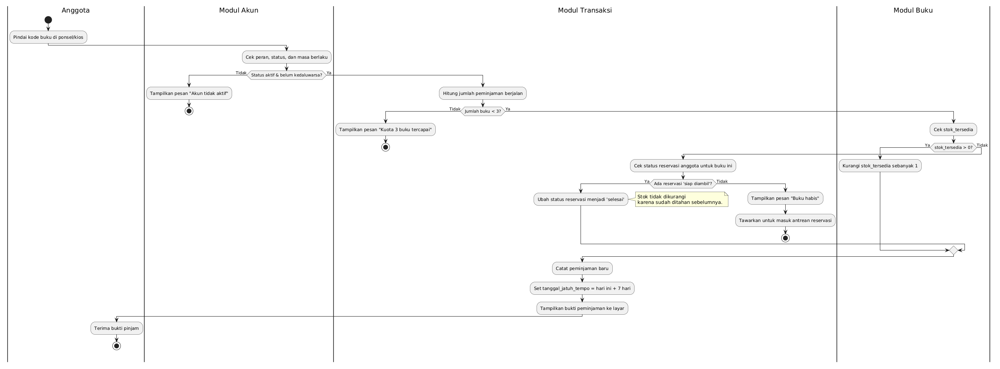
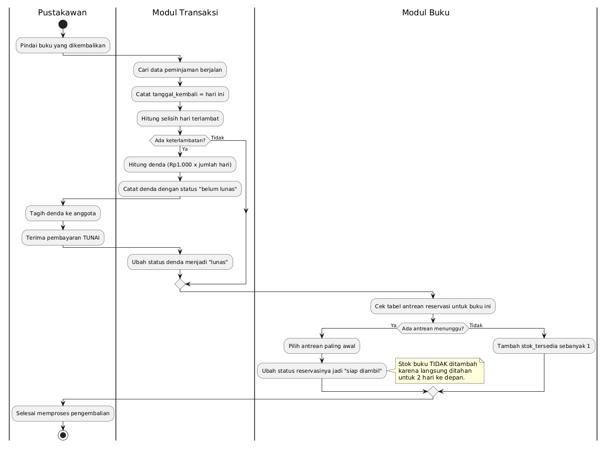
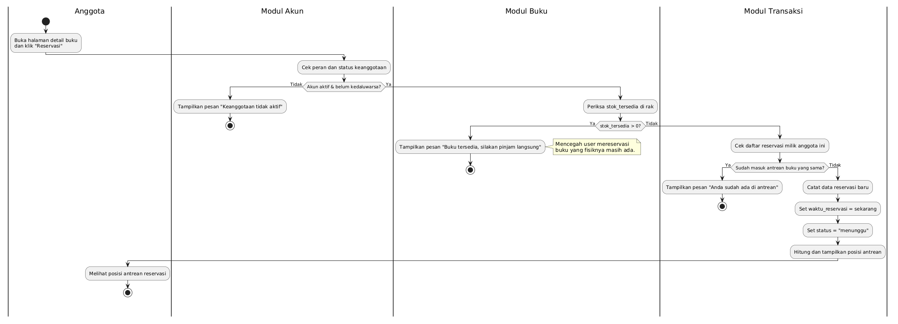
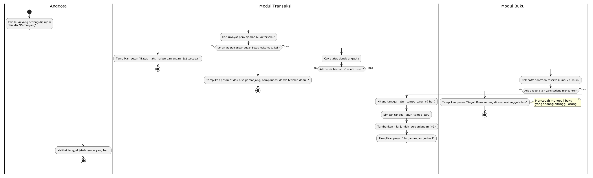
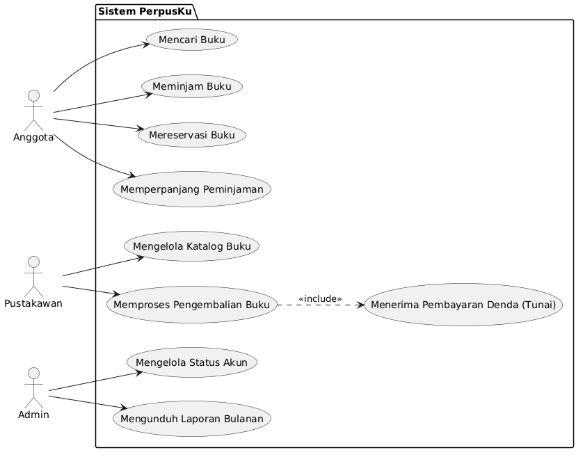
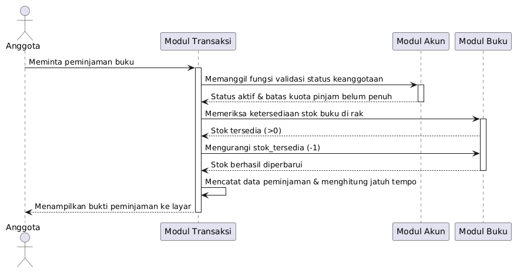
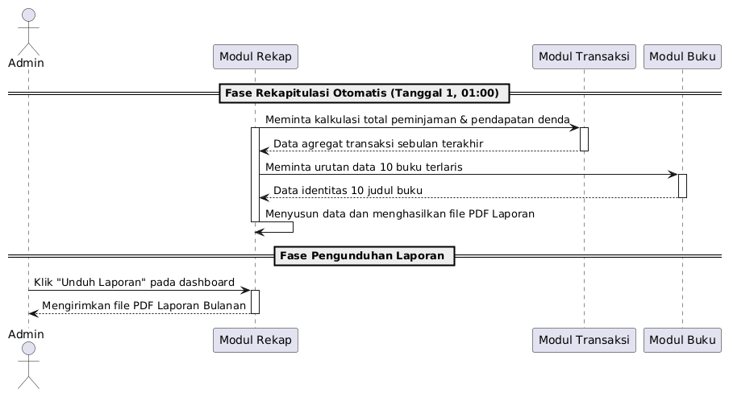

# Kumpulan Diagram Sistem PerpusKu

Semua diagram dibuat dengan **PlantUML**. Setiap diagram punya dua file: kode sumber `.puml` (di folder ini) dan gambar hasil render `.png` (di folder `img/`).

## 1. Activity Diagram (Diagram Alur)

### Alur Peminjaman Buku (Flow 3)

Sumber: [`alur-peminjaman.puml`](alur-peminjaman.puml)

### Alur Pengembalian Buku & Denda (Flow 5)

Sumber: [`alur-pengembalian.puml`](alur-pengembalian.puml)

### Alur Reservasi Buku (Flow 6A)

Sumber: [`alur-reservasi.puml`](alur-reservasi.puml)

### Alur Perpanjangan Buku (Flow 4)

Sumber: [`alur-perpanjangan.puml`](alur-perpanjangan.puml)

## 2. Use Case Diagram

Sumber: [`usecase-perpusku.puml`](usecase-perpusku.puml)

Use Case Diagram ini memetakan batasan operasional Sistem PerpusKu beserta hak akses dari ketiga aktor utamanya (Anggota, Pustakawan, Admin). Diagram ini secara eksplisit memisahkan tugas operasional fisik (Pustakawan) dan tugas analitik/administratif (Admin), serta menggunakan relasi `<<include>>` untuk menunjukkan bahwa fitur "Memproses Pengembalian Buku" memuat rutinitas penanganan denda.

## 3. Sequence Diagram

### Skenario 1: Peminjaman Buku

Sumber: [`sequence-peminjaman.puml`](sequence-peminjaman.puml)

Sequence Diagram ini menggambarkan komunikasi lintas modul pada skenario peminjaman buku oleh Anggota. Sesuai prinsip dekomposisi, **Modul 3 (Transaksi)** bertindak sebagai penggerak utama (orkestrator) yang memanggil **Modul 1 (Akun)** untuk proses validasi identitas, dan memanggil **Modul 2 (Buku)** untuk memanipulasi stok tanpa harus memiliki data tersebut secara langsung.

### Skenario 2: Laporan Bulanan

Sumber: [`sequence-laporan.puml`](sequence-laporan.puml)

Sequence Diagram ini memperlihatkan pemisahan tanggung jawab yang rapi pada skenario penyusunan laporan bulanan. **Modul 4 (Rekap)** berinteraksi menarik data dari **Modul 3 (Transaksi)** dan **Modul 2 (Buku)** secara latar belakang pada pukul 01:00 untuk menghasilkan file PDF, sehingga Admin dapat langsung mengunduhnya kapan saja tanpa membebani performa modul transaksional.
